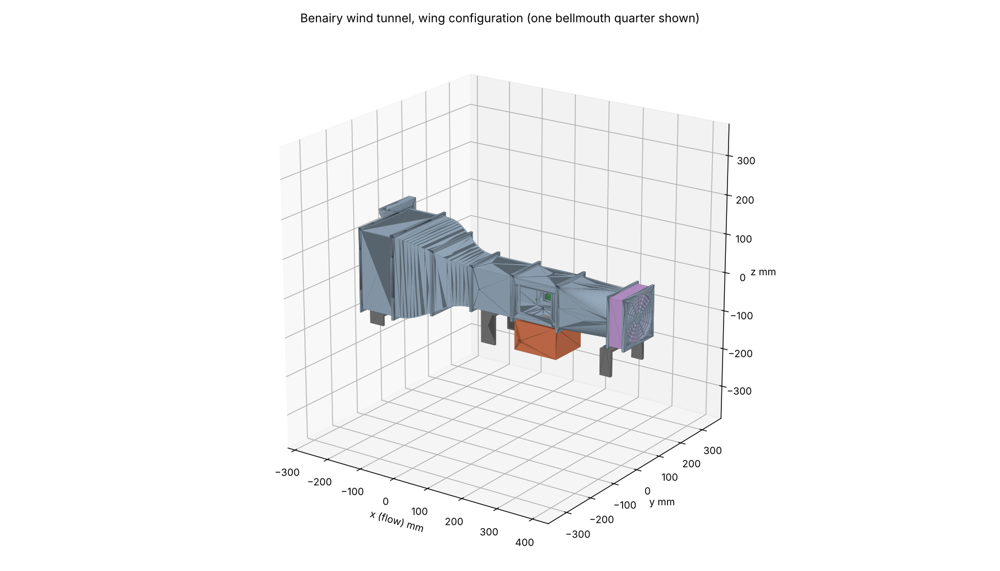
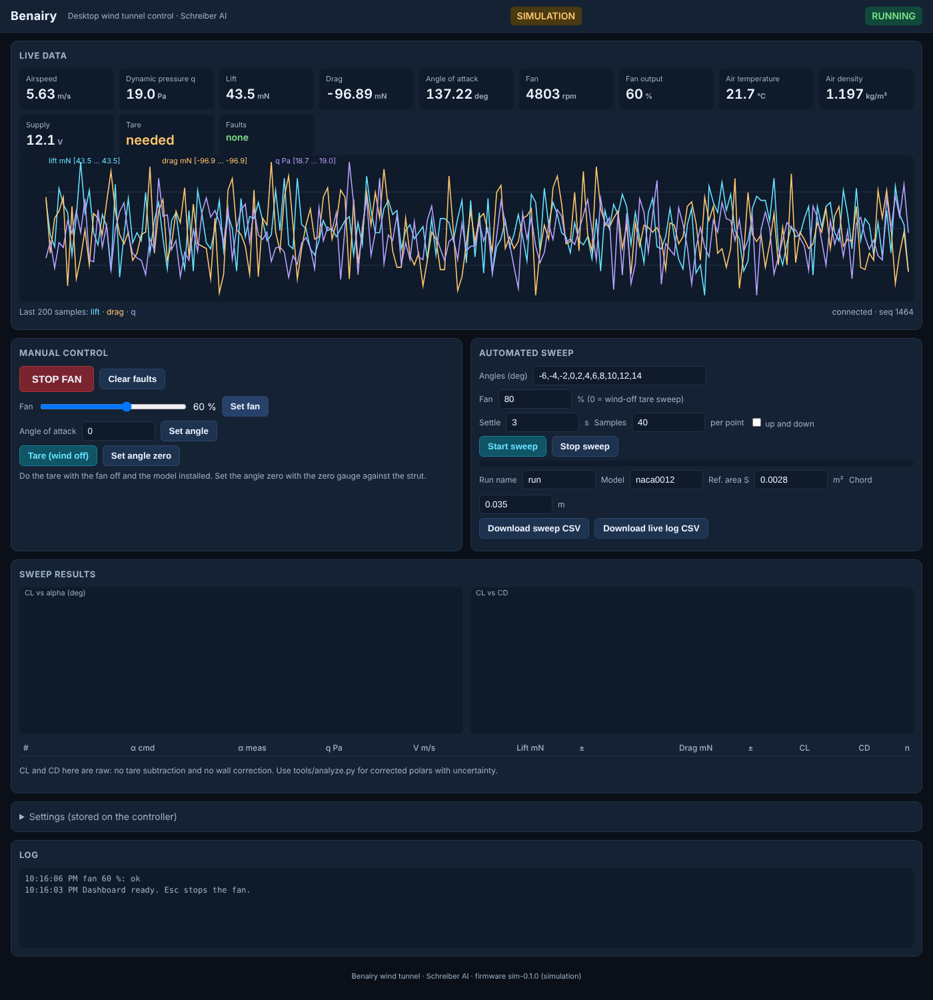
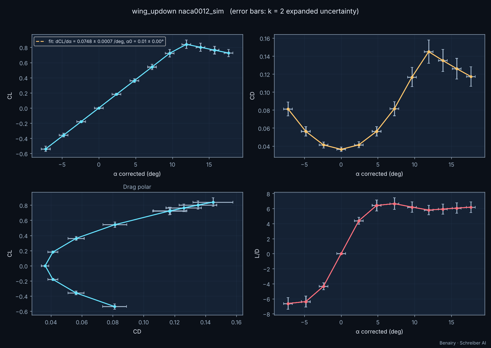

# Benairy

**A desktop wind tunnel you print and build at home, with a two-component force balance for small wings and 1:64 cars.**
By Schreiber AI.



Benairy is an open-circuit suction tunnel with a 100 x 100 mm test section, about 9 m/s of airspeed, a lift and drag balance under the floor, a servo-driven angle of attack with a direct angle sensor, an ESP32 controller with a web dashboard, and Python tools that turn sweeps into corrected polar plots with uncertainty. Purchased parts cost 98 dollars. Every printed part fits a 256 mm bed.

| | |
|---|---|
|  |  |

## Try it without hardware

```bash
pip install numpy scipy matplotlib
python3 sim/server.py --port 8080
```

Open `http://localhost:8080`. Press **Tare**, then **Start sweep**. Download the CSV and analyze it:

```bash
python3 tools/analyze.py --run data/examples/sim_wing_run.csv --tare data/examples/sim_wing_tare.csv --out out
```

The simulator produces in-tunnel forces with wall interference, sensor noise, and drift. The analysis recovers the simulator's free-air lift slope within 1 %.

## What is in the repository

| Folder | Content |
|---|---|
| `cad/` | `benairy_cad.py` parametric generator (runs in plain Python with CadQuery, or inside FreeCAD), `stl/` print-ready files, `step/`, `assembly_stl/`, `renders/`, `check_report.md`, `manifest.json` |
| `docs/` | `design.md`, `parts_list.md`, `build_guide.md`, `test_guide.md`, `PROJECT_STATE.md`, generated design numbers |
| `firmware/` | ESP32 Arduino firmware, `test_host/` unit tests that build with g++ |
| `dashboard/` | Single-file web dashboard (served by the ESP32 and by the simulator) |
| `sim/` | Simulation server with the same HTTP API as the firmware |
| `tools/` | `design_calcs.py`, `analyze.py`, `calibrate.py`, `benairy_analysis.py`, `embed_dashboard.py` |
| `tests/` | pytest suite including the simulated end-to-end run |
| `data/examples/` | Simulated sweeps, calibration data, and analysis output |

## Build order

1. Read `docs/parts_list.md` and order the parts.
2. Print the balance parts first and check the load cell fit. Then print the duct. See `docs/build_guide.md`.
3. Wire the ESP32 (table in the build guide). Flash `firmware/`.
4. Calibrate the balance, the angle zero, and the dynamic pressure factor. See `docs/test_guide.md`.
5. Run Experiment 1. Compare with the example plot.

## Regenerate the CAD

```bash
pip install cadquery trimesh manifold3d shapely
python3 cad/benairy_cad.py        # STL, STEP, manifest
python3 cad/check_cad.py          # bed fit, watertight, overhangs, interference
python3 cad/render_cad.py         # PNG renders
```

Inside FreeCAD: open the Python console or run `freecadcmd cad/benairy_cad.py`. The same script builds every part with the FreeCAD kernel, writes the STL files, and saves `cad/Benairy.FCStd` with a parameter spreadsheet. Edit `PARAMS` at the top of the script to change the design.

## Run the tests

```bash
pip install pytest
python3 -m pytest -q tests
```

## Verification status

| Item | Status |
|---|---|
| CAD: bed fit, watertight meshes, no interference in any configuration | Verified (`cad/check_report.md`) |
| CAD: FreeCAD backend | Implemented, unverified (no FreeCAD in the build environment) |
| Firmware controller core: ramp, stop loop, stall, overload, watchdog, tares, sweeps, calibration | Verified on the host (10 tests) |
| Firmware ESP32 build and sensor drivers | Implemented, unverified (no cross toolchain in the build environment) |
| Dashboard | Verified against the simulator at desktop and phone width |
| Analysis: corrections and uncertainty recover the simulator truth | Verified (simulated) |
| Speed prediction 9.1 m/s, force levels, sensor choice | Calculated; confirm with the pitot wand on the real tunnel |
| Prices | Fan, pressure sensor, servo, TAL221 cell, HX711 confirmed by live listings; others typical |

## Licence

MIT for the code. CC BY 4.0 for the CAD and the documents. Schreiber AI.
